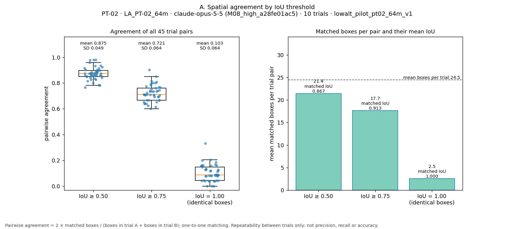
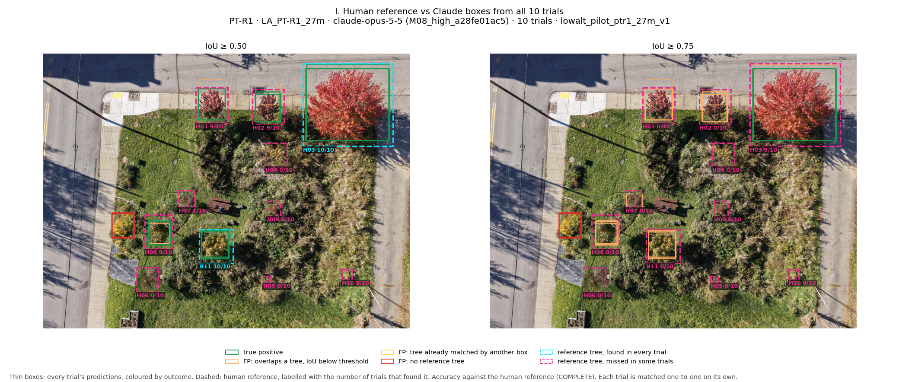

# Research Progress: Repeated-Observation Benchmark of Computer Vision for Urban Trees

*Frontline Labs · Park Triangle urban-tree benchmark · progress report as of 30 October 2026*

This report covers the work held in this repository. It draws only on the saved inference records,
evaluation outputs and human-review files cited in the final section. All findings are **preliminary and
image-specific**: they come from 20 model trials on two drone images, with one completed human reference.

---

## A. Executive Summary

**Research question.** *How consistently do different computer-vision approaches characterize urban vegetation
across repeated standardized observations of the same sites?*

**What has been built.** We now have a reproducible, budget-controlled pipeline. It sends a fixed drone image to
a vision-language model many times under identical settings, and records every response with full provenance.
The outputs are then analysed offline in four separate ways, which answer four different questions:

1. **Count consistency:** does the number of trees reported stay the same from trial to trial?
2. **Spatial repeatability:** do the trials put boxes on the *same places*?
3. **Semantic correctness:** are the boxed objects actually trees, as judged by a human reviewer?
4. **Human-reference accuracy:** how many of the trees a human identified does the model find, and how well
   does it outline them?

**What has been run.** The first model in the roster, M08 (Claude Opus 5.5 at a frozen configuration), was run
10 times on each of two images from the 24 October altitude series:
* **PT-R1** at 26.8 m;
* **PT-02** at 64.3 m.

All 20 trials succeeded, for a total API cost of **$0.92**. For PT-R1, a human annotator outlined 11 trees, and
that reference was approved as complete. It is the only image with a completed reference.

**Most important results.**

* **Stable counts can hide unstable detections.** Both images gave tight counts: PT-R1 averaged 6.1 trees
  (CV 5.2%) and PT-02 averaged 24.5 (CV 7.5%). Yet at IoU ≥ 0.50, none of PT-02's 45 trial pairs boxed exactly
  the same set of objects. In PT-R1, one trial returned the usual six boxes, but three of them were misplaced.
* **Repeatable is not the same as correct.** On PT-R1, eight of the ten trials produced spatially equivalent
  outputs. Even so, the model found on average **4.8 of the 11** reference trees, giving recall 0.44 at
  IoU ≥ 0.50. It also boxed one non-tree plant **in every trial**. Five reference trees were never touched by
  any box in any trial.
* **Box extent matters as much as detection.** In 46 of the 48 matched cases, the model's box lay entirely
  inside the human box, covering on average 69% of its area. Accuracy therefore drops sharply from IoU ≥ 0.50
  (F1 0.56) to IoU ≥ 0.75 (F1 0.11). This reflects a difference in box-drawing convention as much as
  detection skill.
* **PT-02's count of 24.5 is close to the field inventory of 24 trees, but this is not evidence of accuracy.**
  No human reference exists for PT-02 yet, and the image's coverage of the inventoried site is unconfirmed.

**State of the study today.** Repeatability analysis is complete for two images. Human-reference accuracy is
complete for one image (PT-R1). No other model family has been run in this repository yet. Comparisons across
altitudes have a written design but no supporting data or image alignment. The 20-image weekly
before/after collection is catalogued but not yet benchmarked.

---

## B. Research Background

### The Park Triangle project and its two sites

The benchmark uses drone imagery of two Park Triangle sites, **PT-R1** and **PT-02**. The broader study asks
how trustworthy environmental knowledge emerges when human observation, computer vision, drone remote sensing
and geospatial systems are combined. This benchmark contributes the computer-vision part. It does not take a
model's output as fact, but measures how stable that output is when nothing about the input changes, and then
checks it against human observation.

This repository does not document the wider project's history, site selection or the intervention behind the
weekly sessions. Those parts of the background should come from the project's own records, and nothing is
assumed about them here. What the repository does record is in the manifest
(`manifests/manifest.csv`):

| Collection | Images | Dates (2026) | Altitude (relative to takeoff) | Notes |
|---|---|---|---|---|
| Weekly sessions (`standard`) | 20: weeks 1, 3, 4, 5 and 6, both sites | 5 Sep – 10 Oct | ≈ 95 m | Weeks 3–6 are labelled BEFORE and AFTER (morning and afternoon flights). Week 1 is labelled MORNING_START / AFTERNOON_END, and how those labels map to BEFORE/AFTER is still unconfirmed. |
| Altitude series (`low_altitude`) | 10: five per site | 24 Oct, 09:51–10:12 | PT-R1 26.8–31.2 m; PT-02 64.3–85.8 m | One frame per site has its heading rotated by about 90° (`LA_PT-R1_30m_angled`, `LA_PT-02_86m`). |

All 30 images are 8192 × 6144-pixel nadir photographs from the same DJI camera (24 mm 35 mm-equivalent lens).
`coverage_scope` (whether a frame shows the whole site) is still `UNKNOWN` for every image.

### How the two sites differ in the benchmarked images

The two benchmarked frames differ in several ways at once:

| | PT-R1 (`LA_PT-R1_27m`) | PT-02 (`LA_PT-02_64m`) |
|---|---|---|
| Relative altitude | 26.8 m | 64.3 m |
| Estimated ground footprint | ≈ 39 × 29 m | ≈ 93 × 70 m |
| Estimated ground sampling distance, original / as seen by the model | ≈ 4.7 / 17.5 mm per pixel | ≈ 11.3 / 41.9 mm per pixel |
| Visual character | small planted lot: young, mostly separated trees, shrubs, sidewalk and street | dense, often touching canopy between houses and streets |
| Site field inventory (site level) | 11 trees | 24 trees |

Footprint and GSD are estimates from relative altitude and focal length (`evaluation_results/altitude_series.csv`).
The visual descriptions come from inspecting the images.

These differences shape everything that follows. Site, altitude, image scale and canopy structure all differ
between the two images, so **no difference between the two results can be attributed to any single one of
these factors**.

### Objectives of the computer-vision benchmark

1. Quantify how much a model's tree detections vary when the *same* image is analysed repeatedly under fixed
   settings.
2. Separate counting stability from spatial stability, and both from correctness.
3. Build human-validated references so that correctness can be measured, not assumed.
4. Prepare a fair, reproducible basis for comparing model families. Later, extend the comparison to repeated
   observations of the same site under different flight conditions.

---

## C. Experimental Design

### Model roster

| Code | Approach | Status in this repository |
|---|---|---|
| **M08** | Claude Opus 5.5 (vision-language model, structured JSON output) | **Completed** for two images (20 trials) |
| M01, M02 | DeepForest | Recorded in `model_adapters.py` as an existing implementation with frozen results, but **those results are not in this repository** (`deepforest_images/` is empty). Not summarized here. |
| M09 | OpenAI / ChatGPT | **Planned**; no adapter implemented |
| M10 | Gemini | **Planned**; no adapter implemented |
| Copilot | Microsoft Copilot | **Deferred**: no programmatic endpoint identified |
| M03–M07 | — | Not documented in this repository |

### Frozen M08 configuration

M08 has a single configuration. It is stored with every result as configuration id `M08_high_a28fe01ac5`, and
budget pressure can never change it (`BENCHMARK.md`; `model_config.json` in each results folder).

| Setting | Value |
|---|---|
| Model | `claude-opus-5-5` |
| Reasoning effort / thinking | high / adaptive |
| Maximum output tokens | 32,000 |
| Output | Structured JSON against a fixed schema (schema SHA-256 `963a771d…`) |
| Prompt | Fixed annotation prompt template (SHA-256 `e53504b3…`). Site, week and condition labels are inserted. |
| Coordinates | Integer boxes on a 0–1000 grid, `[x_min, y_min, x_max, y_max]` |

### Image preprocessing

The API resizes large images to a fixed visual-token budget. In an early version of the pipeline
(preprocessing v1), images were sent at 2576 × 1932 pixels and silently resized again by the API, by a method we
could not see. Version 2, used for every benchmark trial, resizes locally and deterministically:

* **Resize:** each 8192 × 6144 image goes to exactly **2212 × 1659 pixels** (4,740 visual tokens) with LANCZOS
  resampling.
* **Encoding:** saved as JPEG quality 95.
* **Server-side resizing:** each request asks the API to *reject* rather than resize an oversized image.

Every trial of an image therefore sends byte-identical input, and the recorded upload hash confirms this. The
model sees each image at about 1/3.7 of its original linear resolution. All analysis and drawing uses the
original full-resolution images.

### Repeated-trial protocol

Each image is analysed in **10 independent trials**. Every trial is a new, single-message request with the same
image bytes, prompt, schema and settings. No conversation history or earlier result is passed between trials.
Only failures that never produced a result (network or server errors) are retried. A trial that returns an
invalid response, refuses, or hits the token limit stays recorded as that outcome.

For every trial the pipeline stores:
* the raw API response;
* the validated boxes;
* a full-resolution annotated image;
* token usage and cost;
* the image, prompt and schema hashes;
* the configuration.

### Reproducibility, provenance and spending controls

* **Manifest:** a manifest records every image's path, SHA-256 hash, site, week, condition and capture metadata.
  Images whose prompt-relevant labels are unconfirmed are blocked from paid runs.
* **Spending ledger:** a project-wide ledger records a worst-case cost reservation before each request and the
  actual cost after it. A request starts only if the worst case fits under the cumulative limit, which was $5
  for this phase. Spending outside this project (for example in the Console) is not visible to it, so the
  ledger is a local safeguard, not an account-level cap.
* **Run controls:**
  * runs can be resumed without repeating completed trials;
  * a round-robin mode can alternate images;
  * a safeguard pauses after three consecutive invalid, refused or truncated trials.
* **Offline evaluation:** the evaluation runs entirely offline from the saved records. It re-checks every trial
  against the saved CSVs and the source-image hash, and writes its own configuration, input hashes and software
  versions (`evaluation_results/evaluation_config.json`).

---

## D. Completed Experiments

### The 20 paid M08 trials

| Experiment | Image | Trials | Status | Output tokens per trial | Cost |
|---|---|---|---|---|---|
| `lowalt_pilot_ptr1_27m_v1` | `LA_PT-R1_27m` (26.8 m) | 10 | all `success`, no retries | 200–564 (mean 450) | $0.3439 |
| `lowalt_pilot_pt02_64m_v1` | `LA_PT-02_64m` (64.3 m) | 10 | all `success`, no retries | 1,496–1,795 (mean 1,601) | $0.5741 |

Both runs took place on 30 October 2026. Input was about 6,345 tokens per trial for both images. The ledger
records **$0.91794** spent in total, all confirmed from actual API usage.

One earlier single-request run (`output/tree_counts.csv`, 33 boxes) predates the benchmark pipeline and used
preprocessing v1. Its metadata row is also inconsistent: it labels the file `PT_02.JPG` as site PT R1. It is
**not** part of the benchmark and is not used here.

### Count consistency

| Image | Counts, trials 1–10 | Mean | SD (n−1) | Range | CV |
|---|---|---|---|---|---|
| PT-R1 | 6, 6, 6, 6, 6, 6, 6, 6, 6, 7 | 6.10 | 0.316 | 6–7 | 5.2% |
| PT-02 | 23, 23, 25, 28, 25, 23, 24, 22, 26, 26 | 24.50 | 1.841 | 22–28 | 7.5% |

*Source: `evaluation_results/count_consistency.csv`, verified against each experiment's `counts_summary.csv`.*

### Spatial repeatability

Counting tells us nothing about *where* the boxes are. For spatial repeatability, every pair of trials (45 pairs
per image) is compared box by box:
* **Matching:** each box can pair with at most one box in the other trial. The method maximizes the number of
  pairs above an IoU threshold, then their total IoU.
* **Agreement:** a pair's agreement is 2 × matched boxes ÷ total boxes in the two trials. A value of 1.0 means
  the two trials boxed the same set of objects.
* **Thresholds:** IoU ≥ 0.50 (same object, roughly outlined), IoU ≥ 0.75 (closely outlined) and IoU = 1.00
  (identical coordinates).

| Image | IoU | Mean agreement ± SD | Range | Pairs in full agreement | Mean IoU of matched boxes |
|---|---|---|---|---|---|
| PT-R1 | ≥ 0.50 | 0.919 ± 0.134 | 0.615–1.000 | **28 / 45** | 0.935 |
| PT-R1 | ≥ 0.75 | 0.885 ± 0.199 | 0.462–1.000 | 28 / 45 | 0.945 |
| PT-R1 | = 1.00 | 0.263 ± 0.309 | 0–1.000 | 1 / 45 | 1.000 |
| PT-02 | ≥ 0.50 | 0.875 ± 0.049 | 0.766–0.980 | **0 / 45** | 0.867 |
| PT-02 | ≥ 0.75 | 0.721 ± 0.064 | 0.600–0.902 | 0 / 45 | 0.913 |
| PT-02 | = 1.00 | 0.103 ± 0.064 | 0–0.333 | 0 / 45 | 1.000 |

*Source: `evaluation_results/iou_summary.csv`; figure A for each image.*

**Persistence** asks which locations recur across trials. A *recurring location* is a group of boxes, at most one
per trial, in which every member matches every other member directly. Chains (A matches B, B matches C, but A
does not match C) are flagged as ambiguous rather than merged.

| Image | IoU | Found in all 10 trials | 8–9 | 5–7 | 1–4 | Ambiguous groups (boxes) |
|---|---|---|---|---|---|---|
| PT-R1 | ≥ 0.50 | 4 | 2 | 0 | 3 | 0 |
| PT-R1 | ≥ 0.75 | 3 | 3 | 0 | 4 | 0 |
| PT-02 | ≥ 0.50 | 17 | 2 | 3 | 4 | 5 (36 of 245 boxes) |
| PT-02 | ≥ 0.75 | 9 | 1 | 4 | 15 | 13 (104 boxes) |

*Source: `evaluation_results/persistence_summary.csv`, `detection_persistence.csv`; figures B–D.*

### The PT-R1 human reference

* **Semantic review:** a human reviewer first labelled the recurring PT-R1 locations as **TREE** (6), **NON_TREE**
  (1) or **UNCERTAIN** (2) (`human_review/manual_review.csv`). Both UNCERTAIN units were later identified as
  misplaced trial-6 boxes on trees that other units already cover.
* **Independent reference:** the same person then annotated the image independently in Make Sense, outlining
  **11 trees** (H01–H11). The VOC export is authoritative.
* **Import checks:** the import compared the Pascal VOC and CSV exports. Five boxes differed by exactly one
  pixel on one edge, apparently from rounding. This was recorded, and the VOC coordinates were used unchanged.
* **Approval:** the reference was approved as **complete** on 30 October 2026
  (`human_review/reference_status.csv`).

The annotator found 11 trees in the image, the same number as the PT-R1 site inventory. Whether these are the
same 11 trees has not been formally recorded.

### Human-reference accuracy (PT-R1 only)

Each trial is matched to the 11 reference boxes on its own, with the same one-to-one matching used above.

| IoU | Precision | Recall | F1 | Mean TP / FP / FN per trial | Mean IoU of matched boxes |
|---|---|---|---|---|---|
| ≥ 0.50 | **0.786** ± 0.159 (0.333–0.857) | **0.436** ± 0.094 (0.182–0.545) | **0.561** ± 0.117 (0.235–0.667) | 4.8 / 1.3 / 6.2 | 0.663 |
| ≥ 0.75 | 0.148 ± 0.052 (0–0.167) | 0.082 ± 0.029 (0–0.091) | 0.105 ± 0.037 (0–0.118) | 0.9 / 5.2 / 10.1 | 0.800 |
| = 1.00 | 0 | 0 | 0 | 0 / 6.1 / 11.0 | — |

*Mean ± SD (n−1) across 10 trials, with the range in brackets. Pooling all trials gives the same precision,
recall and F1. Source: `evaluation_results/accuracy_summary.csv`, `accuracy_vs_reference.csv`,
`accuracy_report.md`.*

At IoU ≥ 0.50, by trial:
* trials 1–5 and 7–9 each scored 5 TP / 1 FP / 6 FN (F1 0.588);
* trial 6 scored 2 / 4 / 9 (F1 0.235);
* trial 10 scored 6 / 1 / 5 (F1 0.667).

---

## E. Key Scientific Findings

All findings below come from two images and one model configuration. Treat them as hypotheses to test, not
general conclusions.

### 1. Similar detection counts can conceal spatial instability

The two images have similar count variability (CV 5.2% and 7.5%). Their spatial behaviour is different:

* **PT-R1** is close to all-or-nothing. All 28 pairs among trials 1–5 and 7–9 agree perfectly at both
  IoU ≥ 0.50 and ≥ 0.75. Every imperfect pair involves trial 6 or trial 10.
* **PT-02** never reaches full agreement. Agreement at IoU ≥ 0.50 stays between 0.77 and 0.98 for every pair.
  Only 17 locations recur in all ten trials, although the mean count is 24.5. A further 36 boxes form chains
  in which neighbouring boxes overlap but do not agree as a group. This pattern is consistent with the model
  dividing contiguous canopy differently from one trial to the next (`C_box_variation_iou050.png`).

The clearest single example is PT-R1 **trial 6**. It returned six boxes, like eight other trials, but three of
them were displaced: two onto sidewalk next to street trees, and one only partly covering a tree crown. Its
precision against the reference fell from 0.833 to 0.333, while its count was unchanged. **A count can be
perfectly reproduced while the objects behind it change.**

*Why it matters:* count-based consistency metrics, which are common in canopy and tree-inventory work, would
rate both images, and trial 6, as stable. Spatial and object-level checks are necessary to see the instability.

### 2. High repeatability does not guarantee correct identification

PT-R1 is the most repeatable result in the study: eight of ten trials are spatially equivalent at IoU ≥ 0.50.
Against the human reference, however, the typical trial finds 5 of 11 trees (recall 0.455) and includes one
non-tree. **Repeatability measures whether the model gives the same answer, not whether that answer is right.**
A model that consistently misses the same trees and consistently boxes the same non-tree looks highly
repeatable. The four locations found in all ten trials include one false positive.

### 3. A non-tree object can be consistently misclassified

The most persistent false positive is location **G02**. It is a box found in **all ten trials** with no overlap
with any reference tree, and the reviewer labelled it a plant, not a tree. It accounts for 10 of the 13 false
positives at IoU ≥ 0.50. The model's errors are therefore not random noise that averaging could remove. Some are
systematic: repeating the request makes the same mistake more certain, not less likely.

### 4. Some reference trees are systematically missed

The tree-level results show that omission, not false detection, is the main source of error on PT-R1:

| Reference tree | Size in original pixels | ≈ Size in model input pixels | Found at IoU ≥ 0.50 |
|---|---|---|---|
| H03 | 2014 × 1850 | 544 × 500 | 10/10 |
| H11 | 758 × 751 | 205 × 203 | 10/10 |
| H01, H02, H08 | 613–713 × 758–795 | 166–193 × 205–215 | 9/10 each (missed only in trial 6) |
| H07 | 361 × 373 | 98 × 101 | 1/10 (trial 10 only) |
| H04, H06 | 489 × 523; 480 × 552 | ≈ 130 × 141–149 | **0/10** |
| H09 | 308 × 330 | 83 × 89 | **0/10** |
| H10 | 221 × 222 | 60 × 60 | **0/10** |
| H05 | 165 × 151 | 45 × 41 | **0/10** |

*Source: `evaluation_results/reference_detection_frequency.csv`; figures H–J. Model-input sizes are the original
sizes ÷ 3.70.*

No box from any trial overlapped H04, H05, H06, H09 or H10 at all. In this image, every tree at least about
600 px across was found in at least 9 of 10 trials. Every tree under about 490 px was missed in at least 9 of
10 trials.

Size is the most obvious pattern, but it is not the only difference. Several missed trees are low-contrast
plantings on soil or in grass (figure J). With one image and 11 trees, the size association is a hypothesis to
test, not an established threshold.

### 5. Box extent and localization strongly affect IoU-based accuracy

Two different localization effects appear:

* **Systematic tightness.** In 46 of the 48 matches at IoU ≥ 0.50, the model's box lay entirely inside the human
  box. It covered on average 69% of the human box's area. When one box contains another, IoU equals their area
  ratio. This is why only the largest tree, H03, still matches at IoU ≥ 0.75, and why F1 falls from 0.56 to
  0.11 between those thresholds. It reflects a difference in box-drawing convention: the model outlines a
  tighter crown than this annotator did. On its own, it does not show which convention is correct.
* **Occasional displacement.** In trial 6, boxes for H01 and H02 were shifted onto the sidewalk (IoU 0.333 and
  0.311), and the box for H08 fell to IoU 0.451. Each of these counts as both a false positive and a false
  negative.

The IoU = 1.00 threshold is effectively unreachable against human boxes. The model's coordinate grid has a step of
about 8 original pixels, while the human boxes are drawn to the pixel. At that threshold the metric measures
coordinate reproduction, not detection quality.

### 6. Site characteristics and image acquisition may affect detection behaviour

PT-02 differs from PT-R1 in several ways:

* about 3.5 times more output tokens per trial;
* about four times as many boxes;
* lower but more uniform spatial agreement (0.875 ± 0.049 vs 0.919 ± 0.134);
* chained, ambiguous groups, which never appear on PT-R1.

The two images also differ in site layout and canopy density, in altitude (64.3 vs 26.8 m), and in ground
resolution as seen by the model (about 42 vs 17.5 mm per pixel). The flights also had different headings. **These
factors are completely confounded in the current data**, so none of the differences can be attributed to altitude,
to site, or to canopy structure. In particular, PT-02 has no completed accuracy reference, so **nothing here shows
that the model is more or less accurate on PT-02 than on PT-R1**.

The comparison with the field inventory needs the same care. PT-02's mean of 24.5 is close to its site inventory
of 24, while PT-R1's mean of 6.1 is well below its inventory of 11. On PT-R1, where a reference exists, the six
boxes per trial include one non-tree and miss six real trees. The count is not close to the inventory, and it is
not composed of the right trees either. For PT-02, the closeness to 24 is a numerical coincidence until shown
otherwise, not validated accuracy.

---

## F. Methodological Limitations

* **One completed human reference.** Every accuracy number comes from one image with 11 trees. It does not extend
  to PT-02, other altitudes, other dates or other models. **PT-02 currently supports repeatability analysis only,
  not validated individual-tree detection accuracy.**
* **Small sample.** Twenty paid trials on two images. The trial-to-trial spread estimates *run-to-run* variation
  for one fixed input. It is not *image-to-image* or *site-to-site* variation, and it is not an independent
  estimate of accuracy: all ten trials share the same input, prompt and downscaling, and so share their errors.
* **PT-02 crown boundaries.** In PT-02's dense canopy, individual crowns are often not visually separable. That
  is why the persistence analysis flags chained groups as ambiguous instead of forcing them into single trees.
  Any future PT-02 reference will need an explicit rule for touching or overlapping crowns.
* **Different altitudes and image scales.** The two images differ in ground resolution by a factor of about 2.4.
  Because of the API's fixed visual-token budget, the model sees each image at about 1/3.7 of its original linear
  resolution, which may matter most for small crowns (finding 4).
* **Site and altitude are confounded.** Each site was benchmarked at one altitude, and the two altitudes do not
  overlap (PT-R1 at 27–31 m, PT-02 at 64–86 m). This design cannot separate site effects from altitude effects.
* **Annotation conventions and uncertainty.** The reference is a single annotator's single pass, with no
  agreement check against a second annotator. How much of an irregular crown to include is a judgement, and it
  drives the results at IoU ≥ 0.75 (finding 5).
* **Comparison against site-level inventories.** Inventory counts describe a whole site. Image coverage of each
  site is unconfirmed (`coverage_scope = UNKNOWN`), so inventory comparisons are context, never image-level
  ground truth. The pipeline never uses them to filter or correct predictions.
* **One model configuration.** Every result describes M08 at one frozen configuration and one prompt. It says
  nothing about other configurations or other model families.

---

## G. Engineering and Reproducibility

### Pipeline components

| Component | Role |
|---|---|
| `box_generation.py` | Fixed prompt, output schema and v2 image preprocessing; single-image command-line tool |
| `model_adapters.py` | M08 adapter (retries, error classes, pricing), an offline mock adapter, and placeholders for planned models |
| `benchmark_runner.py` | Manifest-driven repeated trials; project-wide spending ledger and budget guard; resume, round-robin and pause safeguards |
| `make_manifest.py` | Builds the image manifest from file metadata; non-destructive updates and a review list |
| `evaluate_consistency.py`, `evaluation_core.py` | Offline count, spatial and persistence analysis, with exact-arithmetic IoU and optimal one-to-one matching |
| `evaluation_accuracy.py` | Accuracy against a complete human reference, with error types per box |
| `evaluation_plots.py` | Figures A–J, review crops and contact sheets on the full-resolution images |
| `import_reference.py` | Cross-validated import of human reference boxes from Make Sense exports |

### Testing and validation

The suite has **137 offline tests**, all passing, and makes no network calls:
* 77 cover the benchmark runner;
* 44 cover the evaluation;
* 16 cover reference import.

They cover:
* exact IoU at 0.50, 0.75 and 1.00;
* one-to-one matching, checked against brute force;
* ambiguity handling;
* budget accounting across experiments;
* resume and pause behaviour;
* refusal to compare boxes across different images without alignment;
* refusal to compute accuracy against an incomplete reference;
* reproducibility of all outputs.

### Integrity of the human-review data

Two data-integrity problems were caught and resolved without losing any human input:

* **Spreadsheet date conversion.** Opening the review sheet in Excel had turned 40 persistence categories (such as
  `8-9`) into dates (such as `9-Aug`). They were repaired from each row's recorded trial count, after a timestamped
  backup. All nine PT-R1 labels and their reviewer metadata were preserved. Every evaluation now validates the
  review file first and stops with an error rather than using or silently rewriting corrupted values.
  `human_review/README.md` documents a safe Excel workflow.
* **Disagreement between export formats.** The two Make Sense exports differed by one pixel on five boxes. The
  importer refuses such differences unless the user explicitly chooses a source. The choice (VOC) and every
  difference are recorded in the reference rows.

### API expenditure

| Item | Value |
|---|---|
| Paid trials | 20, all successful; no retries, refusals, invalid responses or interruptions |
| Confirmed spend | $0.3439 (PT-R1) + $0.5741 (PT-02) = **$0.9179** |
| Remaining under the $5 project limit | $4.0821 |
| Observed cost per trial | $0.029–0.061, far below the $0.67 worst case reserved per request |

*Source: `spend_ledger/anthropic_api_ledger.jsonl`, `benchmark_results/*/counts_summary.csv`.*

---

## H. Current Research Status

| Status | Item |
|---|---|
| **Completed** | Frozen M08 configuration and v2 preprocessing; reproducible runner with spending ledger |
| **Completed** | 10 trials each on `LA_PT-R1_27m` and `LA_PT-02_64m`; count, spatial and persistence analysis for both |
| **Completed** | PT-R1 semantic review (9 units) and complete 11-tree human reference; accuracy evaluation at 0.50, 0.75 and 1.00 |
| **Completed** | Offline evaluation, visualization, review-validation and reference-import tooling with tests |
| **In progress** | PT-02 human review (62 review units prepared, none labelled yet) |
| **In progress** | Confirmation of `coverage_scope` for all images, and of the week 1 condition labels |
| **Planned** | M08 runs on more images: the remaining altitude frames and the weekly before/after collection |
| **Planned** | Human references beyond PT-R1 |
| **Planned** | Adapters and runs for M09 (ChatGPT) and M10 (Gemini); importing the frozen DeepForest results (M01/M02) |
| **Planned** | Across-altitude robustness analysis (design written in `EVALUATION.md`; requires image registration) |
| **Deferred** | Copilot (no programmatic endpoint) |
| **Deferred** | Tiling or cropping to raise model input resolution (outside the frozen configuration) |
| **Deferred** | Cross-image box comparison (refused by the code until a validated alignment exists) |

---

## I. Next Steps

These are **recommendations**, not completed work. They are ordered by scientific value relative to cost. Items
marked *offline* need no API spending.

1. **Localization diagnostics on PT-R1 (offline).** Finding 5 suggests that some of the drop in accuracy at
   higher thresholds comes from how tightly each side draws boxes, not from detection itself. Report
   centre-distance and containment measures alongside IoU, and plot accuracy over a range of IoU thresholds. Keep
   0.50, 0.75 and 1.00 as the primary thresholds.
2. **Measure annotation uncertainty on PT-R1 (low cost, human time only).** A second independent annotation, or a
   repeat by the same annotator, would show how much of the IoU ≥ 0.75 gap is human variability. A short written
   crown-extent convention would make future references consistent.
3. **Label the 62 PT-02 review units.** This gives semantic correctness (tree vs non-tree) for PT-02's recurring
   detections without first solving full crown delineation. It is a feasible step towards an accuracy reference.
4. **Within-site altitude sensitivity at PT-R1 (paid; requires authorization).** Run M08 on the nadir frames with
   the same heading (`LA_PT-R1_28m`, `_30m`, `_31m`). Each image needs either its own human reference, which is
   feasible for about 11 trees, or a validated registration to the 27 m frame. At the observed cost of about
   $0.034 per PT-R1 trial, 30 more trials would cost about $1, within the remaining budget. Holding the site
   fixed removes the site–altitude confound for this narrow altitude range. Treat the rotated `_30m_angled` frame
   as a separate heading test.
5. **A defensible PT-02 reference.** Options include:
   * crown annotation with an explicit rule for touching crowns and an "uncertain boundary" flag;
   * a point-based (stem or crown-centre) reference from the field inventory, if georeferenced stem positions
     exist;
   * restricting the reference to a sub-area where crowns are separable.
6. **Model-family comparison.** Add M09 and M10 adapters, and bring the frozen DeepForest results into the same
   record format. Then run each model on the same images with the same 10-trial protocol, and evaluate them with
   the same model-agnostic code. Deterministic models such as DeepForest are expected to show perfect
   repeatability. That contrast is itself informative.
7. **Weekly collection.** After the week 1 labels and coverage are confirmed, the 20 weekly images at about 95 m
   allow repeated-observation analysis over time, which is the core of the research question.

---

## Where to Find the Evidence

**Reports and documentation**
- [BENCHMARK.md](BENCHMARK.md): frozen configuration, preprocessing, runner, ledger and budget rules
- [EVALUATION.md](EVALUATION.md): metric definitions, matching and grouping algorithms, human-review workflow,
  accuracy method, across-altitude design
- [evaluation_results/evaluation_report.md](evaluation_results/evaluation_report.md): count, spatial and
  persistence results for both images
- [evaluation_results/accuracy_report.md](evaluation_results/accuracy_report.md): PT-R1 accuracy, per-tree and
  per-error tables
- [manifests/METADATA_REVIEW.md](manifests/METADATA_REVIEW.md): open metadata questions
- [human_review/README.md](human_review/README.md): human-review files and safe editing workflow

**Key data files**
- Inputs: [manifests/manifest.csv](manifests/manifest.csv)
- Saved trials, one folder per trial: `benchmark_results/lowalt_pilot_ptr1_27m_v1/` and
  `benchmark_results/lowalt_pilot_pt02_64m_v1/`, each with `counts_long.csv`, `counts_summary.csv`,
  `boxes_long.csv` and per-trial records
- Spending: `spend_ledger/anthropic_api_ledger.jsonl`
- Count and spatial consistency:
  [count_consistency.csv](evaluation_results/count_consistency.csv),
  [iou_summary.csv](evaluation_results/iou_summary.csv),
  [pairwise_iou.csv](evaluation_results/pairwise_iou.csv),
  [persistence_summary.csv](evaluation_results/persistence_summary.csv),
  [detection_persistence.csv](evaluation_results/detection_persistence.csv)
- Accuracy:
  [accuracy_summary.csv](evaluation_results/accuracy_summary.csv),
  [accuracy_vs_reference.csv](evaluation_results/accuracy_vs_reference.csv),
  [reference_detection_frequency.csv](evaluation_results/reference_detection_frequency.csv),
  [prediction_outcomes.csv](evaluation_results/prediction_outcomes.csv)
- Human input:
  [manual_review.csv](human_review/manual_review.csv),
  [reference_boxes.csv](human_review/reference_boxes.csv),
  [reference_status.csv](human_review/reference_status.csv),
  [field_inventory.csv](human_review/field_inventory.csv), original exports in `human_review/ground_truth/`
- Provenance of the evaluation (inputs, hashes, software versions):
  [evaluation_config.json](evaluation_results/evaluation_config.json)
- Image metadata and estimated ground resolution: [altitude_series.csv](evaluation_results/altitude_series.csv)

**Selected figures**
- Spatial agreement by threshold: `evaluation_results/figures/<experiment>/<image>/A_threshold_comparison.png`
- Persistence maps: `B_persistence_overview.png`, and full-resolution `B_persistence_map_iou050.jpg`
- Box variation within recurring detections: `C_box_variation_iou050.png`
- Trial-by-trial agreement matrix: `D_agreement_matrix.png`
- Count consistency: `E_count_consistency.png`
- PT-R1 accuracy (in `evaluation_results/figures/lowalt_pilot_ptr1_27m_v1/LA_PT-R1_27m/`):
  - `F_accuracy_by_threshold.png`
  - `G_trial_tp_fp_fn.png`
  - `H_reference_detection_frequency.png`
  - `I_reference_vs_predictions_overview.png`
  - `J_error_cases_iou050.png`
- Human reference only: `evaluation_results/review/human_reference_LA_PT-R1_27m.jpg`; review contact sheets in
  `evaluation_results/review/`
